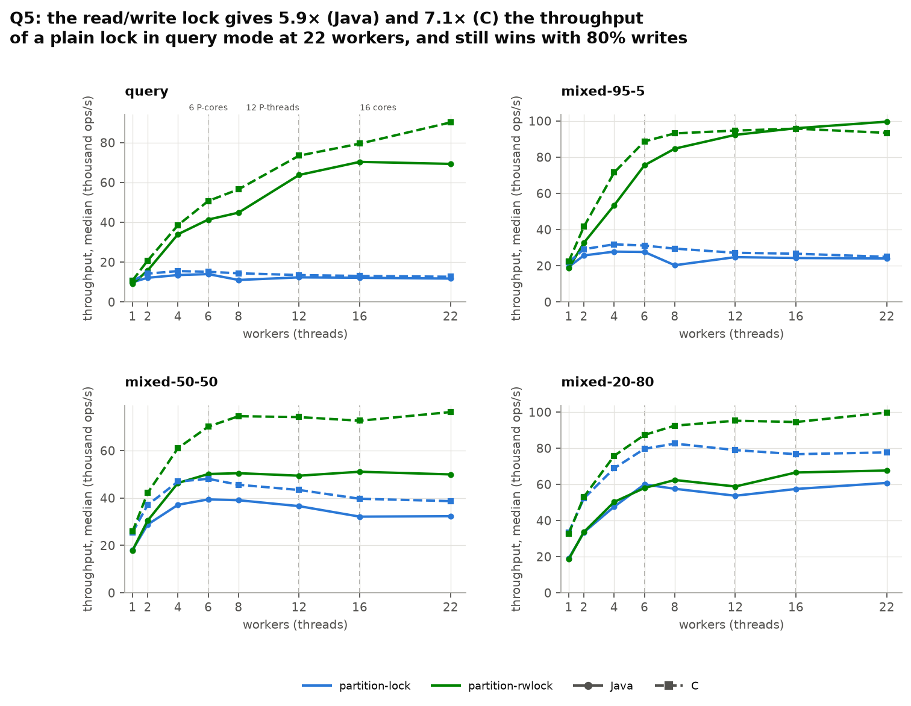

# Concurrent Inverted Index — Benchmark

The same inverted index, written in Java, Go, C++ and C, with 27 implementations in total: four
sequential baselines and 23 concurrent variants (locks, partitions, message passing,
per-worker copies merged at the end, read/write locks). Five questions about concurrency are
answered by measurement on one machine. Each question had a prediction written down before
anything was measured, and the results say which predictions held and which did not.

It is the individual project for the Concurrent and Parallel Systems course. It measures
performance only, and everything is scripted: the runner, the correctness check and the figures.

## Key findings

All numbers are medians of 5 repetitions on one machine (see Method). The full results,
predictions and discussion are in [`docs/experiment-plan.md`](docs/experiment-plan.md).

- **Q1, is the cost the lock or how often it is taken?** Both matter at one lock per posting,
  where every language is slower than the sequential program. With a sensible batch the lock
  is no longer the problem: a single lock serializes about half of the work, so only more locks
  (partitions) help. The best speedup is 3.3× to 5.6× over the sequential program, depending on
  the language.
- **Q2, is sharing worth it?** Replicating the index per worker and merging at the end builds
  faster, but the merge costs more than it saves: sharing (`partition-lock`) has the lower total time
  at every worker count from 2 up, in all four languages. The merge is 26–67% of the total at 16
  workers and takes the same time whatever the number of workers.
  - **Q2b, is it the merge algorithm?** No. A binary-heap merge halves the merge time in Java
    but changes it by 5–10% in C and C++, and sharing still wins everywhere.
- **Q3, locks or messages?** One message per posting is 2–25× slower than locks. With batches of
  64 postings and a big enough mailbox, messages beat locks by 3–14%, but both stop scaling at
  the same point: messages move the bottleneck, they do not remove it.
- **Q4, what does a hybrid CPU do?** Every curve bends at 6 workers (the P-cores) and gains
  little beyond 12, pinned to the P-cores or not. Splitting the documents statically instead of
  handing them out dynamically makes the build 16–19% slower from 8 workers up (measured in C).
- **Q5, does a read/write lock pay off?** Far more than predicted. At 22 workers it gives 5.9×
  (Java) and 7.1× (C) the query throughput of a plain lock, it still wins with 80% inserts, and
  its p99 latency is lower in every mix from 4 workers up.

Memory bandwidth is the suspected limit behind several plateaus (Q1, Q2b, Q2 weak scaling). That
is a hypothesis: no bandwidth counter was recorded.



*Q5: throughput against workers for a plain lock (blue) and a read/write lock (green), Java and C,
at 22 workers up to 7× higher in query mode. Dashed lines mark 6 P-cores, 12 P-core threads and 16 cores.*

## What is inside

Every variant lives in `impl/<language>/<variant>/` and has the same command-line interface.

| Variant | Idea | Languages |
| --- | --- | --- |
| `sequential` | One thread. The baseline for every speedup. | Java, Go, C++, C |
| `global-lock` | One shared index behind one lock; workers insert in batches. | all four |
| `partition-lock` | The index is split by term into P parts, one lock each. | all four |
| `partition-writers` | Split by term; each part has one owner thread, others send it messages through bounded queues. | all four |
| `private-merge` | Each worker builds its own index without locks; the indexes are merged in parallel at the end. | all four |
| `private-merge-heap` | `private-merge` with a binary-heap merge (Q2b). | all four |
| `private-merge-static` | `private-merge` with documents split statically instead of handed out dynamically (Q4). | C |
| `partition-rwlock` | `partition-lock` with a read/write lock per part (Q5). | Java, C |

Java uses `ReentrantLock` and `ReentrantReadWriteLock`, Go `sync.Mutex` and channels, C++ `std::mutex`,
C `pthread_mutex_t` and `pthread_rwlock_t` with its own hash map. Everything uses only the
language's standard library.

## Method in brief

- **Machine:** Intel Core Ultra 7 155H (6 P-cores with hyperthreading, 8 E-cores, 2 LP E-cores:
  16 cores, 22 threads), 31 GB RAM, Linux, plugged in, `performance` profile, no swap in use.
- **Corpus:** English Wikipedia of TU Darmstadt (September 2015), shuffled once with a fixed seed,
  cut into prefixes of 128 to 2048 MB.
- **Identical work:** every language uses the same splitmix64 generator, written by hand, and the
  same exact operation counts and draw order, so the comparison between languages is not
  distorted by a built-in generator.
- **Correctness:** `bench/check.sh` dumps each variant's index on a small test corpus and compares
  it with `cmp`, byte for byte, with the expected dump. It runs at every worker count and in
  every mode the variant supports.
- **Measurement:** 1 warm-up and 5 repetitions per point. Results are raw values, one row per
  repetition; the medians are computed only in the analysis.

The infrastructure and every decision behind it are in [`docs/design.md`](docs/design.md).

## Repository layout

```
bench/       runner (run.sh), correctness check (check.sh), shared code (common.sh)
             and the parameter files (params*.sh)
corpus/      preprocessing: raw Wikipedia -> shuffled corpus, prefixes, queries
data/        corpus prefixes and queries, generated (not committed); data/tiny/ is the
             small hand-made test data used by check.sh
impl/        impl/<language>/<variant>/ with build.sh, run.sh and dimensions.tsv;
             folders starting with _ hold code shared by the variants of a language
results/     one folder per experiment (q1, q2, q2b, q3, q4a, q4b, q5): results.tsv,
             meta.txt, runlist.tsv, failures.tsv, logs/; sizing/ has the sizing measurements
analysis/    Python only here: make_figures.py, requirements.txt, figures/, data/
docs/        design.md and experiment-plan.md
```

New languages and variants are found by scanning `impl/`; no list of them exists anywhere.

## Requirements

- Linux with bash 4+, coreutils (including `timeout`), `awk`, `sed`, `taskset`, `cmp` and `git`.
- JDK 25 (`javac`, `java`), Go (no `go.mod` needed), `g++`, `gcc`.
- Python 3 with pandas, numpy and matplotlib, only to regenerate the figures (the benchmark
  itself needs no Python and no third-party libraries).

## Reproducing

Prepare the data once. The source is 4.4 GB
([DOI 10.5281/zenodo.229904](https://doi.org/10.5281/zenodo.229904)):

```
mkdir -p data/raw
curl -L -o data/raw/wikipedia.txt.gz https://zenodo.org/api/records/229904/files/wikipedia.txt.gz/content
md5sum data/raw/wikipedia.txt.gz                                 # c1fefd53b73798459e8623e2b965f75f
zcat data/raw/wikipedia.txt.gz | corpus/extract.sh | corpus/normalize.sh > data/raw/corpus-dump-order.txt
corpus/shuffle.sh bench/params.sh < data/raw/corpus-dump-order.txt > data/raw/corpus.txt
corpus/make-prefixes.sh bench/params.sh data/raw/corpus.txt      # data/corpus-<MB>mb.txt
corpus/make-queries.sh bench/params.sh data/corpus-512mb.txt     # data/queries.txt
```

Check that every variant builds the right index (prints one PASS/FAIL row per variant; exit code 0
only if all pass):

```
./bench/check.sh                    # worker counts of bench/params-quick.sh
./bench/check.sh bench/params.sh    # worker counts of another params file
```

Run an experiment. Each params file is one experiment; the numbers below are from the runs
committed in `results/`:

| Params file | Experiment | Runs | Measured |
| --- | --- | --- | --- |
| `bench/params-q1.sh` | Q1: locks and batching, build, 128 MB | 292 | 58 min |
| `bench/params-q2.sh` | Q2: sharing or replicating, strong and weak scaling | 272 | 115 min |
| `bench/params-q2b.sh` | Q2b: heap merge against linear merge | 36 | 6 min |
| `bench/params-q3.sh` | Q3: locks or messages | 292 | 61 min |
| `bench/params-q4a.sh` | Q4: pinned to the P-cores, up to 12 workers | 58 | 9.5 min |
| `bench/params-q4b.sh` | Q4: static against dynamic handout | 44 | 7 min |
| `bench/params-q5.sh` | Q5: read/write lock, query and mixed modes, 512 MB | 136 | 58 min |
| `bench/params-quick.sh` | small sweep for development (also the default of `check.sh`) | – | not part of the results |
| `bench/params-pinned.sh` | every variant pinned to the P-cores | 722 | not run |
| `bench/params.sh` | every variant, every mode | 11,547 | not run (too long for one sitting) |

```
./bench/run.sh bench/params-q1.sh    # results go to results/q1/<timestamp>/
```

Regenerate the figures from the committed results (PNG and SVG in `analysis/figures/`):

```
python3 -m venv analysis/.venv       # if this fails: sudo apt install python3-venv
analysis/.venv/bin/pip install -r analysis/requirements.txt
analysis/.venv/bin/python analysis/make_figures.py            # figures
analysis/.venv/bin/python analysis/make_figures.py --slides   # 16:9 versions in analysis/figures/slides/
analysis/.venv/bin/python analysis/make_figures.py --numbers  # the numbers quoted in the plan
```

## Results and data

Each experiment is committed as `results/<experiment>/<timestamp>/` with `results.tsv` (one row per
repetition, times in ns and sizes in bytes), `meta.txt` (machine, commit, power and swap state, a
copy of the params file), `runlist.tsv`, `failures.tsv` (empty: no run failed) and `logs/`.

The columns of `results.tsv` come in three groups: the context of the run (machine, commit,
language, variant and its dimensions, mode, corpus size, workers, batch and so on), the
measurements (phase times: load, preload, build, run, finalize; counts of documents, terms and
postings; peak memory; CPU time; context switches) and `work_n` for weak scaling. The exact
definitions are in [`docs/design.md`](docs/design.md), section Results.

The raw per-query latency files of Q5 (136 files, about 200 MB) are kept outside the repository.
The figures use the percentile table `analysis/data/q5-latency-percentiles.tsv`, which is
committed. To recompute it from the raw files, put them in `results/q5/<timestamp>/latencies/`
and add `--rebuild-latency-table` to `make_figures.py`.

## Documents

- [`docs/design.md`](docs/design.md): the infrastructure and methodology: workload, data, command-line
  interface, results format, measurement rules.
- [`docs/experiment-plan.md`](docs/experiment-plan.md): the five questions, the predictions, the
  variants, and the full results and discussion of each experiment.
- [`report.pdf`](report.pdf): the final presentation (in Italian): the five questions, the
  results and the lessons.

## License and data

The code is under the MIT license, see [`LICENSE`](LICENSE). The corpus is not included. It is the
English Wikipedia text corpus of TU Darmstadt (A. Panchenko), licensed CC BY 4.0, available at
[DOI 10.5281/zenodo.229904](https://doi.org/10.5281/zenodo.229904).
